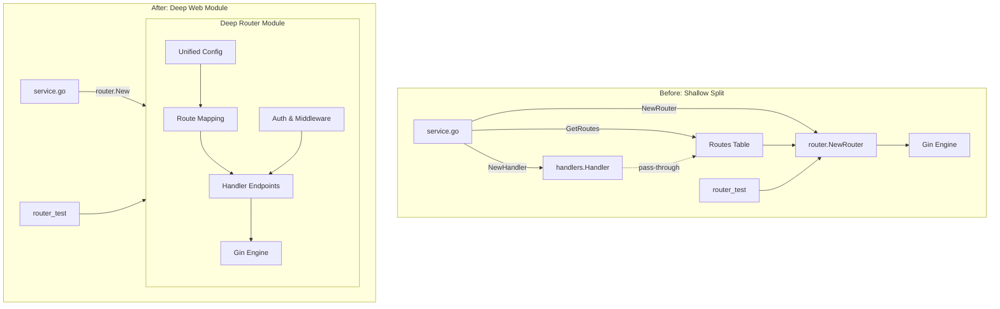
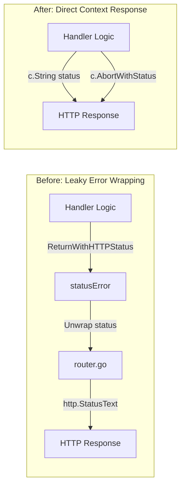
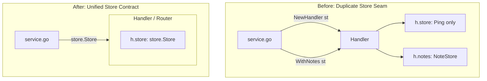

# Codebase Architecture Review: Deepening Opportunities

Evaluated on October 10, 2026 for **Angel** (Release `v1.0.7`).

The aim is to identify architectural friction and propose **deepening opportunities**: refactoring shallow modules into deep ones to maximize caller **leverage**, maintainer **locality**, and **testability**.

---

## Candidates at a Glance

| # | Candidate | Strength | Category | Summary |
|---|---|---|---|---|
| **1** | [Collapse HTTP handlers into router](#1-collapse-http-handlers-into-the-router) | **Strong** | `in-process` | Fold shallow `handlers` into `router`, dropping intermediate `Routes` table. |
| **2** | [Retire `httperror` package](#2-retire-httperror-and-eliminate-pass-through-error-wrapping) | **Strong** | `in-process` | Remove 44-line pass-through error wrapper in favor of direct context status codes. |
| **3** | [Consolidate `store.Store`](#3-consolidate-storestore-and-eliminate-redundant-notestore-seam) | **Worth exploring** | `ports & adapters` | Remove duplicate `NoteStore` alias and `WithNotes` option left from ADR-0008. |
| **4** | [Retire `utils` package](#4-retire-utils-and-inline-binary-path-detection) | **Worth exploring** | `in-process` | Eliminate dead `GetUrl` code and inline binary path detection into `config`. |

---

## 1. Collapse HTTP handlers into the router

### Involved Files
- `handlers/handlers.go`
- `handlers/client.go`
- `handlers/notes.go`
- `handlers/entry.go`
- `handlers/health.go`
- `router/router.go`
- `router/routes.go`

### Problem
The HTTP tier is split across two shallow packages:
- `handlers.Handler` contains thin methods taking `*gin.Context` and returning `error`.
- `router` defines an intermediate `Routes` slice mapping HTTP methods and paths to `handlers.Handler` methods, and manages middleware, trusted proxies, and static asset serving.
- In practice, `handlers` cannot be tested in isolation (only `handlers/health_test.go` exists). All 16 other web test suites live in `router_test` and test end-to-end through `router.NewRouter`.
- Tracing an endpoint requires hopping between `router/routes.go` (for path and role constraints) and `handlers/*.go` (for actual logic).

### Solution
Fold the handler methods directly into `router` (or a unified web package). The router absorbs the route mapping table and binds dependencies directly from its configuration.

### Diagram



### Architectural Wins
- **Locality**: Routing rules, authorization roles, and endpoint logic co-locate.
- **Leverage**: Callers initialize one cohesive web module without intermediate constructors.
- **Interface shrinks**: Eliminates the `Route` slice indirection and `handlers.Option` functions.
- **Deletion test**: The entire shallow `handlers` package is deleted.

---

## 2. Retire `httperror` and eliminate pass-through error wrapping

### Involved Files
- `httperror/httpError.go`
- `httperror/httpError_test.go`
- `handlers/notes.go`
- `handlers/entry.go`
- `handlers/client.go`
- `router/router.go`

### Problem
`httperror` is a 44-line pass-through package defining `statusError`:
```go
type statusError struct {
    error
    status int
}
```
Every handler wraps errors with `httperror.ReturnWithHTTPStatus(err, status)`. In `router.go`:
```go
c.String(httperror.HTTPStatus(err), httperror.StatusText(err))
```
`httperror.StatusText(err)` discards the underlying error text and only outputs standard `http.StatusText(status)` (e.g. `"Internal Server Error"`). The wrapped error is never exposed to callers.

### Solution
Delete `httperror`. Handlers respond with standard Gin methods (`c.String(status, ...)` or `c.AbortWithStatus(...)`) directly at the point of failure.

### Diagram



### Architectural Wins
- **Deletion test**: Pass-through complexity completely vanishes.
- **Locality**: Error status codes are emitted directly at the point of failure.
- **Simplicity**: Removes 28 occurrences of `httperror.ReturnWithHTTPStatus` boilerplate.
- **Cleanup**: Deletes the entire `httperror` package.

---

## 3. Consolidate `store.Store` and eliminate redundant `NoteStore` seam

### Involved Files
- `store/storage.go`
- `handlers/handlers.go`
- `service.go`

### Problem
[ADR-0008](file:///home/johan/repos/johansundell/angel/docs/adr/0008-retire-template-stores-and-request-logging.md) retired the template stores and request logging, leaving `store.Store` as the single unified storage interface for notes, acknowledgements, and health checks:
```go
type NoteStore = Store
```
However, `handlers.Handler` still keeps two separate struct fields:
- `h.store`: used only for `Ping` in `HealthCheck`
- `h.notes`: used for `GetDailyNote`, `SaveDailyNote`, etc.

Callers in `service.go` must pass the database instance twice:
```go
handlers.NewHandler(st, ..., handlers.WithNotes(st))
```
If `WithNotes` is accidentally omitted, the note endpoints fail closed at runtime with `errNotesNotConfigured`.

### Solution
Drop `type NoteStore = Store` and `WithNotes`. Have handlers take `store.Store` once, satisfying both health checks and daily note storage.

### Diagram



### Architectural Wins
- **Locality**: Single storage seam at initialization.
- **Safety**: Eliminates half-configured fail-closed states.
- **ADR alignment**: Completes the storage consolidation initiated by ADR-0008.

---

## 4. Retire `utils` and inline binary path detection

### Involved Files
- `utils/utils.go`
- `utils/utils_test.go`
- `config.go`
- `router/router.go`

### Problem
`utils` is a 29-line grab-bag package containing:
1. `GetUrl(r *http.Request)`: 100% dead code; called nowhere except in its own unit test.
2. `GetBinaryBasePath()`: A 5-line helper (`filepath.Dir(os.Executable())`) used in only two initialization locations.

### Solution
Delete `GetUrl`, inline `filepath.Dir(os.Executable())` into `config.go` (or `types/settings`), and delete `utils/`.

### Architectural Wins
- **Deletion test**: Dead code disappears.
- **Locality**: Path resolution co-locates with configuration loading.
- **Package health**: Eliminates generic grab-bag package anti-pattern.

---

## Recommended Sequence

1. **Quick Wins**:
   - Retire `utils` (Candidate 4).
   - Retire `httperror` (Candidate 2).
   - Consolidate `store.Store` (Candidate 3).
2. **Major Deepening**:
   - Collapse `handlers` into `router` (Candidate 1).
